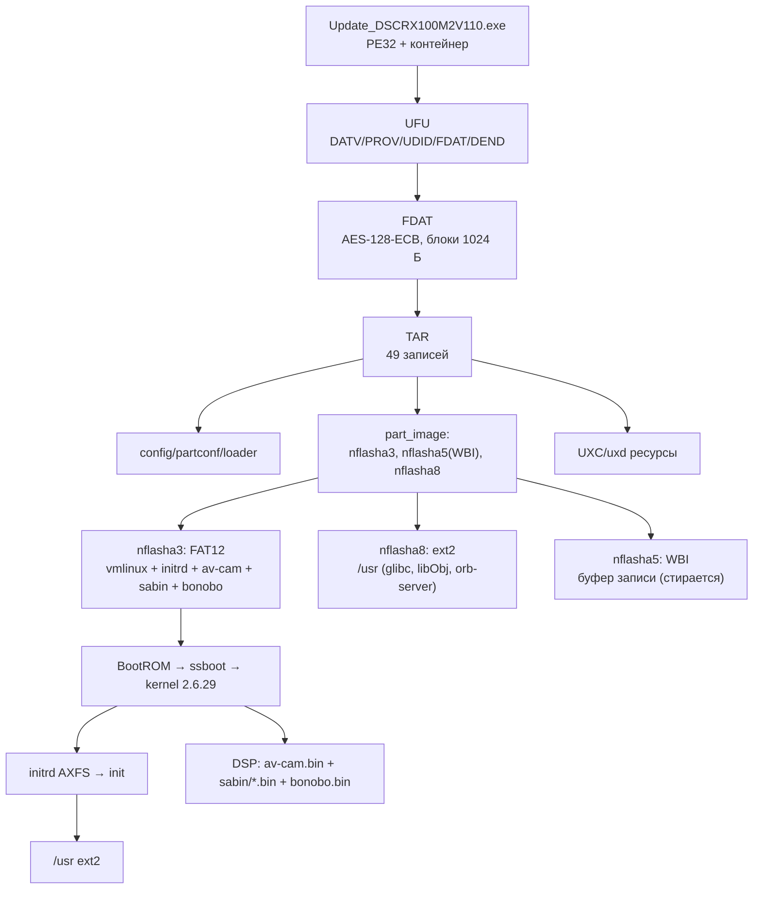
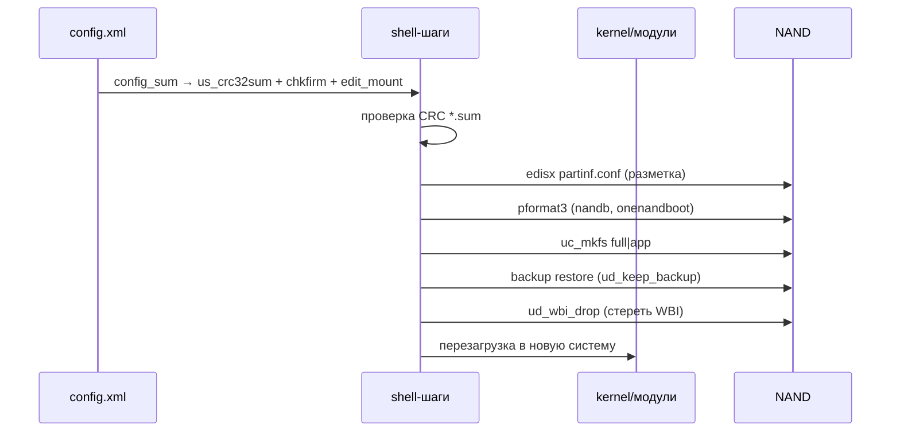
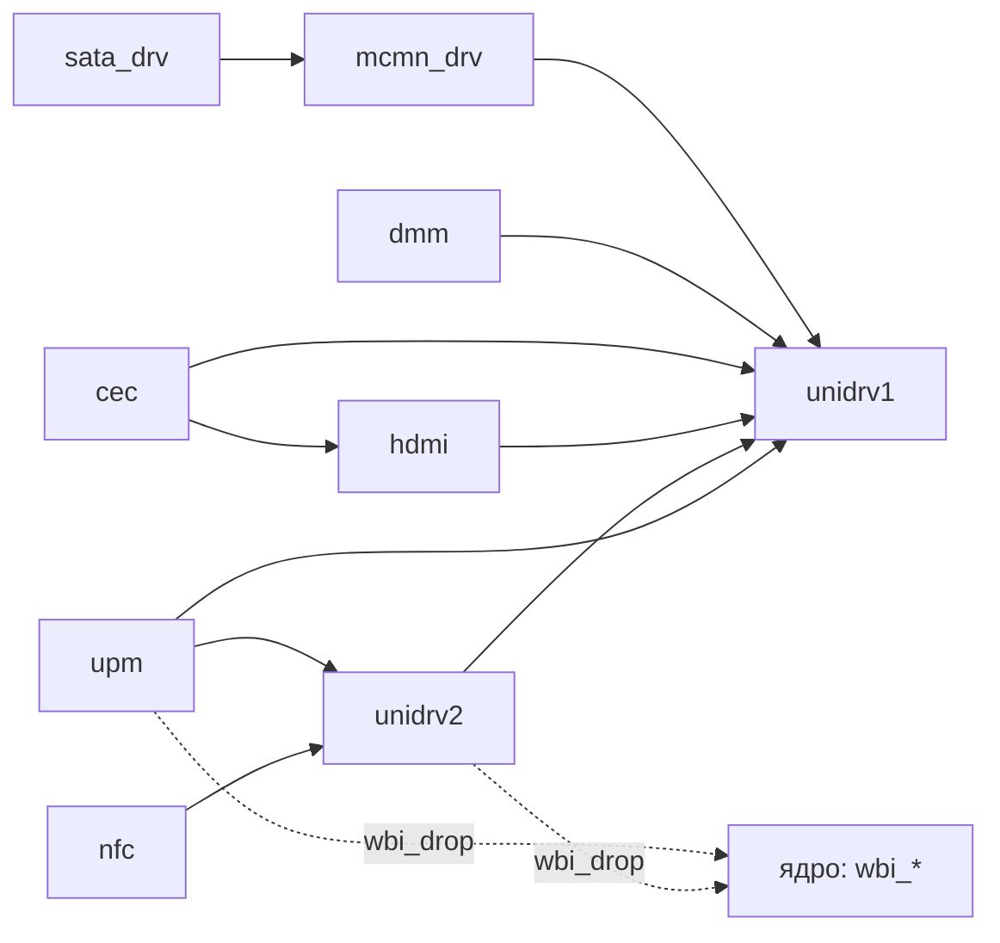
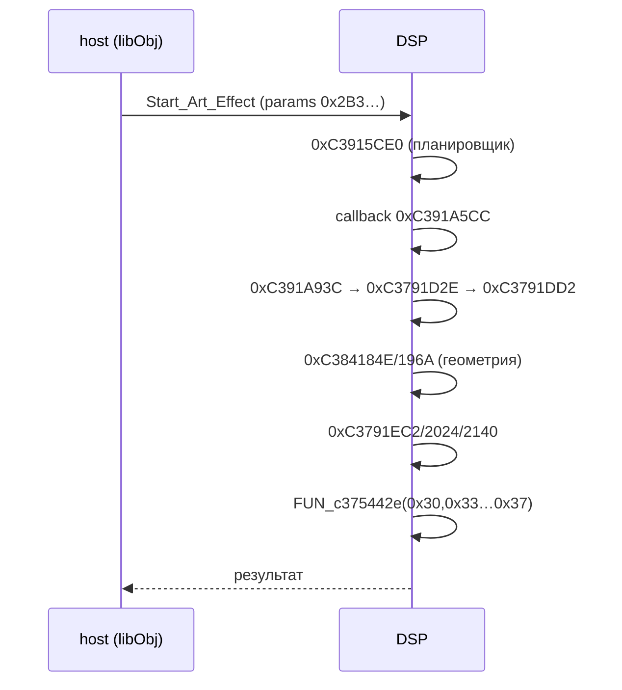

# Архитектура и взаимодействия (диаграммы)

Схемы составлены по фактам из `docs/`; пунктир — предположения.

## 1. Состав прошивки и загрузка

## 2. Обновление (updater body)

## 3. Модули ядра (по графу зависимостей)

## 4. DSP art-effect

## Ограничения

Схемы не показывают тайминги и реальные вызовы; DSP-часть — статический
каркас, а не трассировка.
